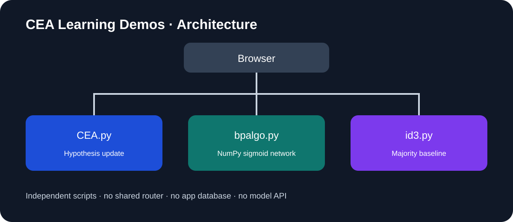

# 🧠 CEA Learning Demos

[](https://github.com/Brajesh31/cea/actions/workflows/ci.yml)
[](https://github.com/Brajesh31/cea/actions/workflows/codeql.yml)


Three independent Python and Streamlit classroom demonstrations of machine-learning concepts: Candidate-Elimination-style hypothesis updates, a tiny NumPy sigmoid network, and a synthetic majority-class baseline.

> ⚠️ Educational software only. These examples are not production ML systems, validated algorithm libraries, or suitable for hiring, medical, financial, credit, insurance or other high-impact decisions.

[Documentation hub](docs/README.md) · [Installation](docs/installation.md) · [Contributing](CONTRIBUTING.md) · [Security](SECURITY.md) · [Roadmap](ROADMAP.md)

## ✨ Applications

| Entry point | Demonstration | Run |
|---|---|---|
| `CEA.py` | Candidate-Elimination-style weather examples | `streamlit run CEA.py` |
| `bpalgo.py` | Tiny NumPy sigmoid network and one gradient update | `streamlit run bpalgo.py` |
| `id3.py` | Generated feature table and majority-class dummy baseline | `streamlit run id3.py` |

Each command starts a separate Streamlit application. There is no shared launcher, router or common session. The extensionless `bpalgo` file is a byte-for-byte duplicate of `bpalgo.py`; use the Python-named entry point.

## 🧰 Technology and requirements

Python, Streamlit, NumPy and pandas. Runtime dependencies are in `requirements.txt`; development/test dependencies are in `requirements-dev.txt`. CI currently runs Python 3.11. The project does not yet publish a full lock file or broad OS compatibility guarantee.

## 🚀 Quick start

```bash
python -m venv .venv
# macOS/Linux
source .venv/bin/activate
# Windows PowerShell: .\.venv\Scripts\Activate.ps1
python -m pip install --upgrade pip
python -m pip install -r requirements.txt
streamlit run CEA.py
```

Use `streamlit run bpalgo.py` or `streamlit run id3.py` for the other demos. Stop with Ctrl+C. For tests, install `requirements-dev.txt` and run `python -m pytest`.

## 🔬 What the code actually does

### Candidate Elimination-style demo
`CEA.py` accepts newline-separated examples split on comma-space. Each row is expected to contain four attributes and a Yes/No class. The function initializes a specific hypothesis from the first row regardless of class and applies simplified updates.

**Limitation:** it is not a correct implementation of full Candidate Elimination version-space boundaries for arbitrary data. It does not validate row width, labels or consistency. Results are illustrative only.

### Backpropagation demo
`bpalgo.py` initializes a random 2×2 weight matrix and 2×1 biases, calculates sigmoid outputs and applies one update against a hard-coded two-value target. The dataset text area parses and displays rows only, it does not train on them.

Streamlit reruns the script and the network is constructed again, so learned parameters are not retained between interactions. This is a shape-specific teaching example, not a general trainer or evaluation pipeline.

### ID3-named baseline
`id3.py` generates 100 synthetic rows with four normally distributed features and three random integer classes. It predicts the most frequent class for every row.

Despite the filename, it does **not** build an ID3 decision tree. Its displayed accuracy is calculated against the same labels used to select the majority class, so it is an in-sample baseline, not a generalization estimate.

## 🗺️ Architecture and diagrams



- [Candidate Elimination concept](docs/assets/candidate-elimination-concept.svg)
- [Neural-network dimensions](docs/assets/neural-network-shapes.svg)
- [Majority-baseline pipeline](docs/assets/majority-baseline-pipeline.svg)
- [All Mermaid diagrams](docs/diagrams/README.md)
- [Asset index and policy](docs/assets/README.md)

## 🗂️ Repository structure

```text
cea/
├── CEA.py
├── bpalgo.py
├── bpalgo
├── id3.py
├── requirements.txt
├── requirements-dev.txt
├── pytest.ini
├── tests/
│   ├── test_demos.py
│   ├── test_fixture_integrity.py
│   └── test_numerical_characterization.py
├── docs/
│   ├── algorithms/
│   ├── api/
│   ├── assets/
│   ├── data/
│   ├── diagrams/
│   ├── examples/
│   ├── experiments/
│   ├── operations/
│   ├── security/
│   ├── templates/
│   └── testing/
├── notebooks/
├── .github/
│   ├── ISSUE_TEMPLATE/
│   ├── DISCUSSION_TEMPLATE/
│   └── workflows/
├── CONTRIBUTING.md
├── CODE_OF_CONDUCT.md
├── SECURITY.md
├── SUPPORT.md
├── CHANGELOG.md
├── ROADMAP.md
└── LICENSE
```

## 🧪 Quality and verification

The repository has pytest-based characterization tests and GitHub Actions for compilation/tests. These checks cover selected behavior only. They do not prove full Candidate Elimination correctness, a complete backpropagation derivation, or an ID3 tree implementation.

```bash
python -m pip install -r requirements-dev.txt
python -m compileall -q CEA.py bpalgo.py id3.py
python -m pytest
```

## 🔐 Data and privacy

The current code does not intentionally send entered values to a remote service or persist them to an application database. Streamlit sessions and hosting-provider logs/backups are separate considerations. Do not enter real personal, confidential or regulated information. Keep examples synthetic.

## 🧭 Learning path

1. Start with [the guided learning path](docs/LEARNING_PATH.md) and [educator guide](docs/EDUCATOR_GUIDE.md).
2. Inspect [the algorithm comparison](docs/ALGORITHM_COMPARISON.md).
3. Review the [model/demo card](docs/MODEL_CARD.md), [dataset card](docs/DATASET_CARD.md) and [reproducibility guide](docs/REPRODUCIBILITY.md).

## 🤝 Contributing

Read [CONTRIBUTING.md](CONTRIBUTING.md), follow [CODE_OF_CONDUCT.md](CODE_OF_CONDUCT.md), use the issue/PR templates and submit focused changes with synthetic examples and explicit verification evidence.

## 🛡️ Security

These demos are not secure multi-user production services. Report vulnerabilities privately according to [SECURITY.md](SECURITY.md). Never put secrets or sensitive data in issues.

## 📚 Documentation map

- [All documentation](docs/README.md)
- [Algorithm correctness review](docs/algorithms/CORRECTNESS_REVIEW.md)
- [Input formats](docs/INPUT_FORMATS.md)
- [Testing strategy](docs/testing/TESTING_STRATEGY.md)
- [Threat model](docs/security/THREAT_MODEL.md)
- [Reusable templates](docs/templates/README.md)
- [Optional Jupyter notebook](notebooks/README.md)

## 📄 License

See [LICENSE](LICENSE). Third-party packages and media retain their respective licenses.
